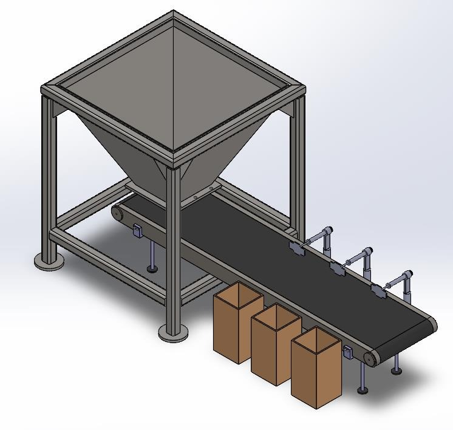
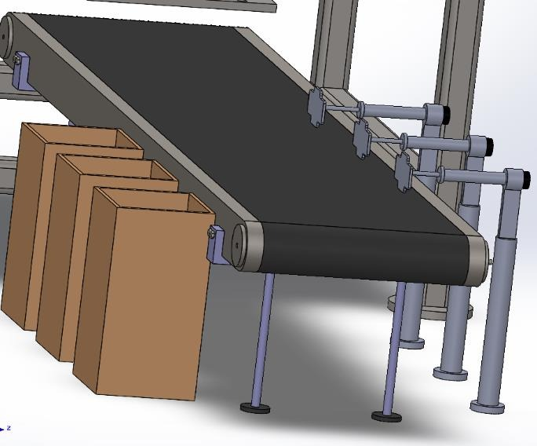
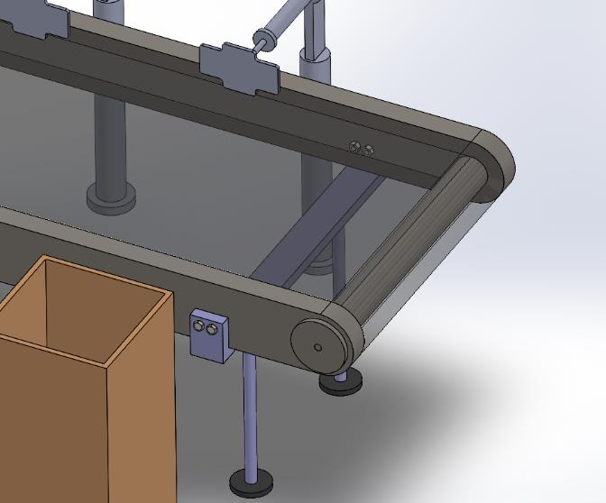
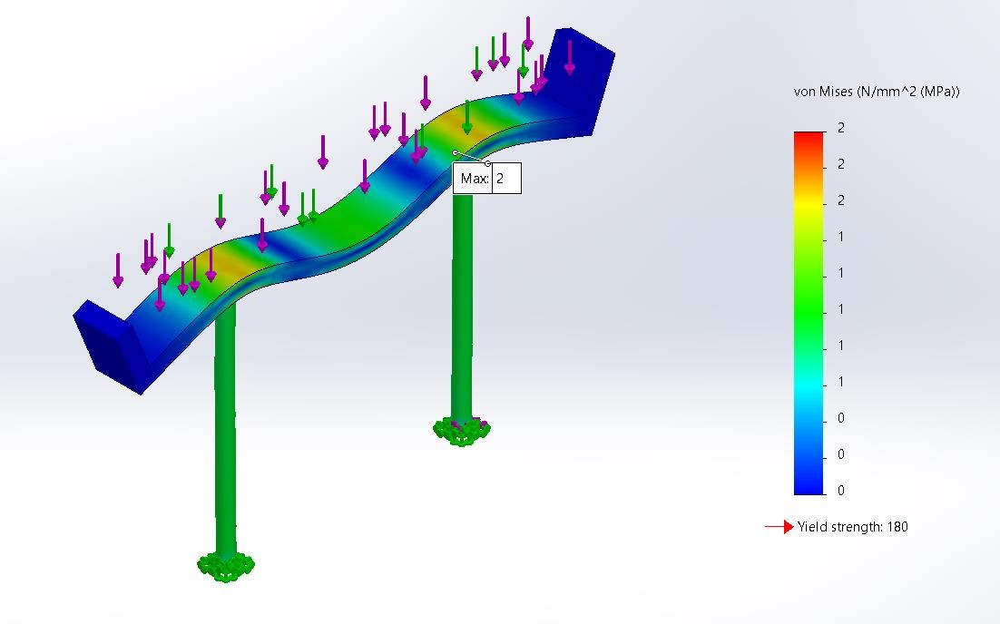

# Waste-Sorting Conveyor: Mechanical Design in SolidWorks

Design of a hopper-fed belt conveyor that carries mixed municipal waste under a camera, where pushers divert ferrous metals, non-ferrous metals and plastics into three bins. The project covers the full SolidWorks assembly and the machine-design calculations behind it: bearings, shafts, legs and bolts.

<p align="center"></p>

**Course:** MEE 422 Mechanical Engineering Design, Lebanese American University (Fall 2025)
**Team:** Khalid Kaddoura, Rayan Abou Matar

## What I did

- Designed the full assembly in SolidWorks: hopper, frame, belt, rollers, shafts, legs and drive.
- Sized belt speed, motor speed and bearings, then checked the shafts for fatigue with the modified Goodman and Langer criteria.
- Verified the legs against buckling and stress (FEA), and the frame bolts against shear.

## How it works

1. **Feed.** A 0.25 m³ hopper with sloped walls drops mixed waste steadily onto the belt.
2. **Convey.** A flat rubber belt on two bearing-supported shafts moves items at 0.2 m/s, one at a time.
3. **Detect.** A camera above the belt classifies each item as ferrous metal, non-ferrous metal or plastic.
4. **Sort.** Three pushers along the belt fire at the right moment to divert each item into its bin; anything unclassified rides off the end.

<p align="center">
  
  
</p>

## Design calculations

| Component | Check | Result |
|---|---|---|
| Drive | Belt speed 0.2 m/s on a 6 mm shaft | 636.6 rpm |
| Bearings | Load rating for 19,000 h at 90% reliability | C₁₀ = 132 N → 6 mm bore, 20 mm OD |
| Shafts | AISI 1045 CD, Ø6 mm, bending + torsion with stress concentration | n = 1.57 (Goodman), 1.62 (Langer), infinite life |
| Legs | Axial stress and Euler buckling | 0.94 MPa; minimum radius 1.1 mm vs 5 mm used |
| Legs (FEA) | Von Mises stress in SolidWorks | ≈ 2 MPa maximum |
| Bolts | M4 frame bolts in pure shear | n = 9.36 |

<p align="center"></p>

## Repository contents

```
docs/Design_Report.pdf          full report with calculations, BOM and shop drawings
docs/Design_Presentation.pptx   final presentation
media/                          renders and analysis images
```

SolidWorks CAD files are not included.

## Tools

SolidWorks (modeling, assembly, simulation) · Shigley's machine-design methods

Portfolio: [khalidkadd1.github.io](https://khalidkadd1.github.io)
